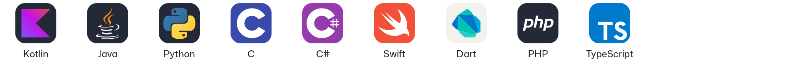
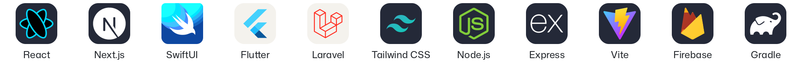
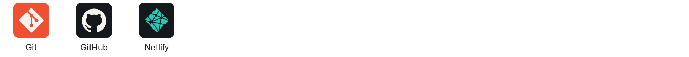

<h1 align="center">¡Hola! Soy Xavier Hijós 👋</h1>

  <strong>Estudiante de Desarrollo de Aplicaciones Multiplataforma (DAM)</strong>

  Aplicaciones móviles · Desarrollo web · Proyectos colaborativos

  
  
  

---

## 👨‍💻 Sobre mí

Me interesa desarrollar aplicaciones móviles y web con **interfaces intuitivas**, una lógica sólida y una buena integración de datos. He trabajado en proyectos individuales y colaborativos que incluyen consumo de APIs, persistencia de datos, aplicaciones en tiempo real y pruebas automatizadas.

## 🛠️ Tecnologías y herramientas

**Lenguajes de programación y web**

  <picture>
    <source media="(prefers-color-scheme: dark)" srcset="assets/tech-icons/languages-programming-dart-v4-20261123-dark.png">
    <source media="(prefers-color-scheme: light)" srcset="assets/tech-icons/languages-programming-dart-v4-20261123-light.png">
    
  </picture>

  <picture>
    <source media="(prefers-color-scheme: dark)" srcset="assets/tech-icons/languages-web-v3-20261123-dark.png">
    <source media="(prefers-color-scheme: light)" srcset="assets/tech-icons/languages-web-v3-20261123-light.png">
    
  </picture>

**Desarrollo de aplicaciones y frameworks**

  <picture>
    <source media="(prefers-color-scheme: dark)" srcset="assets/tech-icons/ides-v2-20261123-dark.png">
    <source media="(prefers-color-scheme: light)" srcset="assets/tech-icons/ides-v2-20261123-light.png">
    
  </picture>

  <picture>
    <source media="(prefers-color-scheme: dark)" srcset="assets/tech-icons/frameworks-flutter-laravel-v3-20261123-dark.png">
    <source media="(prefers-color-scheme: light)" srcset="assets/tech-icons/frameworks-flutter-laravel-v3-20261123-light.png">
    
  </picture>

**Bases de datos, pruebas y herramientas**

  <picture>
    <source media="(prefers-color-scheme: dark)" srcset="assets/tech-icons/databases-v2-20261123-dark.png">
    <source media="(prefers-color-scheme: light)" srcset="assets/tech-icons/databases-v2-20261123-light.png">
    
  </picture>

  <picture>
    <source media="(prefers-color-scheme: dark)" srcset="assets/tech-icons/testing-v4-20261123-dark.png">
    <source media="(prefers-color-scheme: light)" srcset="assets/tech-icons/testing-v4-20261123-light.png">
    
  </picture>

  <picture>
    <source media="(prefers-color-scheme: dark)" srcset="assets/tech-icons/tools-v4-20261123-dark.png">
    <source media="(prefers-color-scheme: light)" srcset="assets/tech-icons/tools-v4-20261123-light.png">
    
  </picture>

## 🚀 Proyectos públicos destacados

| Proyecto | Qué he desarrollado | Tecnologías principales |
| --- | --- | --- |
| [**FitnessApp**](https://github.com/XavierHR1/FitnessApp) | Aplicación Android para consultar ejercicios desde una API, registrar el peso, calcular el IMC y gestionar un perfil local. | Kotlin · Jetpack Compose · Retrofit · Coil · SharedPreferences · JUnit |
| [**HorseApp**](https://github.com/XavierHR1/HorseApp) | Aplicación Android con un listado de caballos sincronizado en tiempo real mediante Cloud Firestore. | Kotlin · Jetpack Compose · Material 3 · Firebase Firestore |
| [**Portafoli OpenCode**](https://github.com/XavierHR1/portafolis-opencode) | Portafolio interactivo con búsqueda y filtros para explorar proyectos. | Next.js · React · TypeScript · Tailwind CSS |
| [**Portafolio web**](https://github.com/XavierHR1/XavierHR1.github.io) | Página personal modular y adaptable a distintos dispositivos, creada sin frameworks de frontend. | HTML · CSS · JavaScript |

## 🔧 Experiencia en proyectos colaborativos y privados

También he participado en desarrollos cuyo código no es público:

- **Aplicaciones multijugador y en tiempo real:** comunicación cliente-servidor, sincronización de estado y persistencia con **TypeScript, Node.js, Socket.IO y SQLite**.
- **Aplicaciones web colaborativas:** trabajo con **React, Next.js y Supabase**, en equipos que utilizan herramientas de componentes, validación y pruebas como **Storybook, Playwright y Vitest**.

## 🧩 Odoo y personalización de ERP

En proyectos académicos he creado **módulos de Odoo con Python** y personalizado módulos existentes para adaptarlos a nuevos requisitos.

## 🌍 Comunidad tecnológica

He participado en la organización de la **[Qiskit Hackathon BCN](https://github.com/XavierHR1/Qiskit-Hackathon-BCN)** y en iniciativas universitarias de ingeniería y tecnología.

