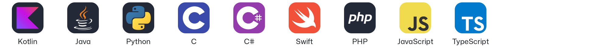

<h1 align="center">¡Hola! Soy Xavier Hijós 👋</h1>

  <strong>Estudiante de Desarrollo de Aplicaciones Multiplataforma (DAM)</strong>

  Desarrollo Android y Apple · Desarrollo web · Aplicaciones en tiempo real

  
  
  

---

## 👨‍💻 Sobre mí

Soy estudiante del **Grado Superior de Desarrollo de Aplicaciones Multiplataforma (DAM)**. Me interesa crear aplicaciones que combinen una interfaz cuidada, una lógica sólida y una buena gestión de los datos.

- 📱 **Desarrollo Android:** aplicaciones con **Kotlin, Jetpack Compose, Material 3** e interfaces **XML**; integración con **Firebase Firestore**, consumo de APIs mediante **Retrofit y Gson**, carga de imágenes con **Coil** y persistencia local con **SharedPreferences**.
- 🍎 **Desarrollo Apple:** programación con **Swift** y creación de interfaces con **SwiftUI** utilizando **Xcode**.
- 🌐 **Desarrollo web:** proyectos con **HTML, CSS, JavaScript, TypeScript, React, Next.js y Tailwind CSS**.
- 🔄 **Aplicaciones en tiempo real:** proyectos con **Node.js, Express, Socket.IO, Phaser y Vite**, incluyendo lógica de juego, salas multijugador y comunicación cliente-servidor.
- 🗄️ **Programación y bases de datos:** conocimientos de **Java, Python y PHP**, y experiencia con **SQL, PL/SQL, MySQL, MariaDB, MongoDB y SQLite**.
- 🧩 **ERP:** experiencia académica con **Odoo**, creando módulos propios en **Python** y adaptando módulos estándar del ERP.
- 🤝 **Colaboración:** participación en proyectos de desarrollo de software y en iniciativas de la comunidad tecnológica.

## 🛠️ Tecnologías y herramientas

**Lenguajes de programación y web**

  <picture>
    <source media="(prefers-color-scheme: dark)" srcset="assets/tech-icons/languages-programming-20261123-dark.png">
    <source media="(prefers-color-scheme: light)" srcset="assets/tech-icons/languages-programming-20261123-light.png">
    
  </picture>

  <picture>
    <source media="(prefers-color-scheme: dark)" srcset="assets/tech-icons/languages-web-20261123-dark.png">
    <source media="(prefers-color-scheme: light)" srcset="assets/tech-icons/languages-web-20261123-light.png">
    
  </picture>

**Desarrollo de aplicaciones y frameworks**

  <picture>
    <source media="(prefers-color-scheme: dark)" srcset="assets/tech-icons/ides-v2-20261123-dark.png">
    <source media="(prefers-color-scheme: light)" srcset="assets/tech-icons/ides-v2-20261123-light.png">
    
  </picture>

  <picture>
    <source media="(prefers-color-scheme: dark)" srcset="assets/tech-icons/frameworks-v2-20261123-dark.png">
    <source media="(prefers-color-scheme: light)" srcset="assets/tech-icons/frameworks-v2-20261123-light.png">
    
  </picture>

**Bases de datos, pruebas y herramientas**

  <picture>
    <source media="(prefers-color-scheme: dark)" srcset="assets/tech-icons/databases-v2-20261123-dark.png">
    <source media="(prefers-color-scheme: light)" srcset="assets/tech-icons/databases-v2-20261123-light.png">
    
  </picture>

  <picture>
    <source media="(prefers-color-scheme: dark)" srcset="assets/tech-icons/testing-v4-20261123-dark.png">
    <source media="(prefers-color-scheme: light)" srcset="assets/tech-icons/testing-v4-20261123-light.png">
    
  </picture>

  <picture>
    <source media="(prefers-color-scheme: dark)" srcset="assets/tech-icons/tools-v4-20261123-dark.png">
    <source media="(prefers-color-scheme: light)" srcset="assets/tech-icons/tools-v4-20261123-light.png">
    
  </picture>

**Integración Android, pruebas y calidad**

  
  
  
  

**Desarrollo de videojuegos, tiempo real y ERP**

  
  
  
  

También he trabajado con **XML y .NET**, navegación con **Jetpack Navigation Compose**, gestión de estado con **ViewModel** y herramientas de pruebas y calidad como **JUnit, Vitest, Playwright, ESLint y Prettier**.

## 🚀 Proyectos públicos destacados

| Proyecto | Qué he desarrollado | Tecnologías principales |
| --- | --- | --- |
| [**FitnessApp**](https://github.com/XavierHR1/FitnessApp) | Aplicación Android para consultar ejercicios desde una API, registrar el peso, calcular el IMC y gestionar un perfil local. | Kotlin · Jetpack Compose · Retrofit · Coil · SharedPreferences · JUnit |
| [**HorseApp**](https://github.com/XavierHR1/HorseApp) | Aplicación Android con un listado de caballos sincronizado en tiempo real mediante Cloud Firestore. | Kotlin · Jetpack Compose · Material 3 · Firebase Firestore |
| [**Portafoli OpenCode**](https://github.com/XavierHR1/portafolis-opencode) | Portafolio interactivo con búsqueda y filtros para explorar proyectos. | Next.js · React · TypeScript · Tailwind CSS |
| [**Portafolio web**](https://github.com/XavierHR1/XavierHR1.github.io) | Página personal modular y adaptable a distintos dispositivos, creada sin frameworks de frontend. | HTML · CSS · JavaScript |
| [**BMI Jetpack Composer**](https://github.com/XavierHR1/BMI-Jetpack-Composer) | Aplicación Android para calcular el índice de masa corporal. | Kotlin · Jetpack Compose |
| [**Frases de M. Rajoy**](https://github.com/XavierHR1/FrasesdeMRajoy) | Aplicación Android que muestra una frase aleatoria al pulsar un botón. | Kotlin · Android · XML |

## 🔧 Experiencia en proyectos colaborativos y privados

Además de los repositorios públicos, participo en otros desarrollos cuyo código no está disponible públicamente.

- **Aplicaciones multijugador y tiempo real:** desarrollo con **TypeScript, Phaser, Vite, Node.js, Express y Socket.IO**; trabajo con comunicación cliente-servidor, sincronización de estado, persistencia con **SQLite** y pruebas automatizadas con **Vitest**.
- **Aplicaciones web colaborativas:** participación en entornos basados en **React, Next.js, Supabase, TanStack Query, Zod, React Hook Form, Radix UI y Framer Motion**, entre otras herramientas.
- **Componentes, visualización y calidad:** experiencia en entornos que incorporan **Storybook, Playwright, Recharts, FullCalendar, Mapbox GL y MapLibre GL**.

*Las tecnologías enumeradas reflejan herramientas presentes en proyectos en los que participo; su inclusión no implica especialización individual en todas ellas. No se divulga código ni información interna de repositorios privados.*

## 🧩 Odoo y personalización de ERP

En el ámbito académico he trabajado con **Odoo**, desarrollando **módulos personalizados en Python** y modificando módulos predefinidos del ERP para adaptar su comportamiento a distintos requisitos.

## 🌍 Comunidad tecnológica

He participado en la organización de la **[Qiskit Hackathon BCN](https://github.com/XavierHR1/Qiskit-Hackathon-BCN)**, dedicada a la computación cuántica, y en otras iniciativas universitarias relacionadas con la ingeniería y la tecnología.

---

  <strong>Aprendiendo, construyendo y mejorando con cada proyecto.</strong>

